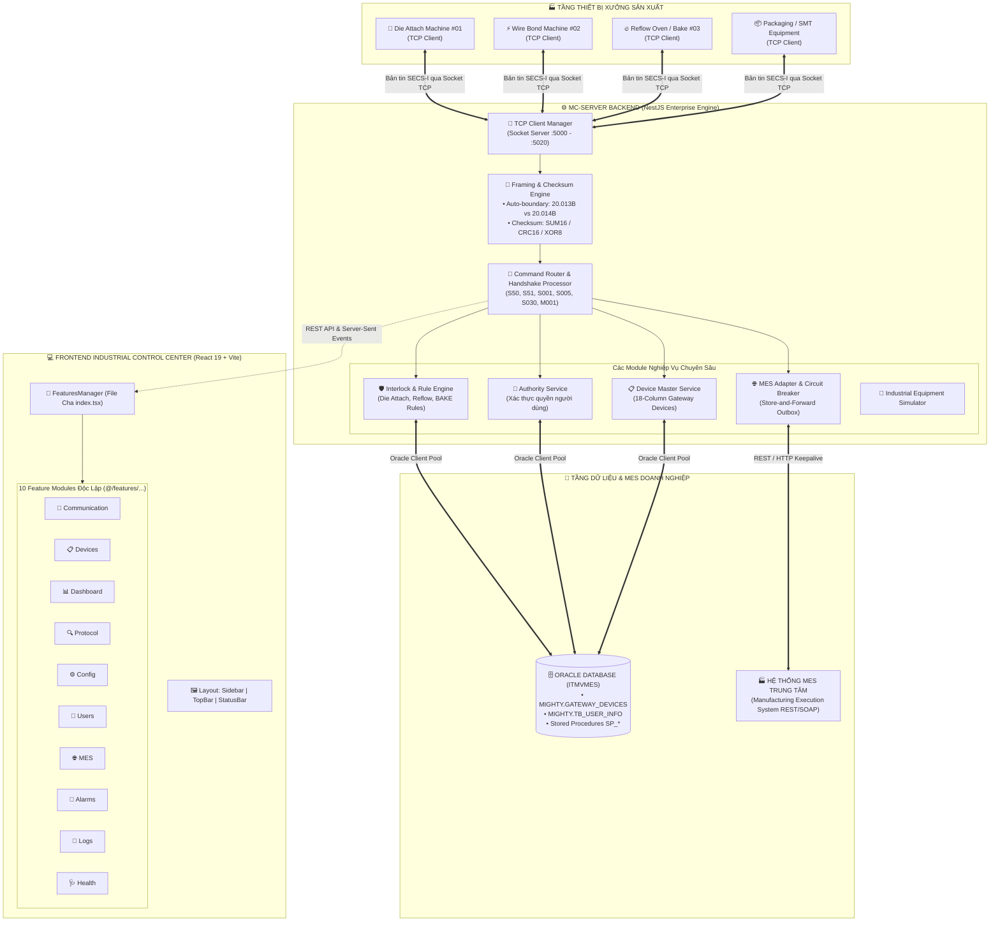

# 🏭 MC SERVER INDUSTRIAL ENTERPRISE EDITION
### Hệ Thống Máy Chủ Giao Tiếp Sản Xuất Thông Minh & Trung Tâm Điều Hành Công Nghiệp 4.0

[](https://react.dev/)
[](https://nestjs.com/)
[-F80000?logo=oracle&logoColor=white)](https://www.oracle.com/database/)
[](https://en.wikipedia.org/wiki/SECS/GEM)
[](./ARCHITECTURE.md)
[](./src/core/i18n)

---

## 📖 MỤC LỤC
1. [Giới Thiệu Tổng Quan](#1-giới-thiệu-tổng-quan)
2. [Sơ Đồ Kiến Trúc Hệ Thống (Architecture Diagram)](#2-sơ-đồ-kiến-trúc-hệ-thống)
3. [Phân Tích Chi Tiết Tầng Backend (BE Engine)](#3-phân-tích-chi-tiết-tầng-backend-be-engine)
4. [Phân Tích Chi Tiết Tầng Frontend (FE Control Center)](#4-phân-tích-chi-tiết-tầng-frontend-fe-control-center)
5. [Quy Trình Nghiệp Vụ & Mã Lệnh Bản Tin (Handshakes & Protocols)](#5-quy-trình-nghiệp-vụ--mã-lệnh-bản-tin)
6. [Cấu Trúc Thư Mục Dự Án (Directory Structure)](#6-cấu-trúc-thư-mục-dự-án)
7. [Hướng Dẫn Cài Đặt & Vận Hành (Getting Started)](#7-hướng-dẫn-cài-đặt--vận-hành)
8. [Tự Chuẩn Đoán & Kiểm Thử (Diagnostics & Verification)](#8-tự-chuẩn-đoán--kiểm-thử)

---

## 1. GIỚI THIỆU TỔNG QUAN

**MC Server Industrial Enterprise Edition** là nền tảng máy chủ kết nối và điều hành trung tâm (Mission-Critical Manufacturing Communication Server) được thiết kế cho các nhà máy sản xuất công nghệ cao (Smart Factories / Bán dẫn / Đóng gói vi mạch SMT / Die Attach / Wire Bond).

Hệ thống đóng vai trò cầu nối thời gian thực:
- **Giao tiếp tầng xưởng (Shopfloor Equipment):** Kết nối socket TCP hai chiều đồng thời tới hàng trăm thiết bị công nghiệp theo chuẩn giao thức SECS-I/TCP, xử lý phân mảnh bản tin (Fragmentation) và ghép gói (Coalescing).
- **Kiểm soát quy tắc liên động (Interlock Verification):** Xác thực nghiêm ngặt mã lô (Lot No), quyền hạn công nhân (`SP_CHECK_USER_AUTH`), công thức sản xuất (Recipe), và tiến trình luồng qua các Stored Procedures Oracle (`SP_EPBV_CHECK_ILRULE`, `SP_EPBC_CHECK_ILRULE`).
- **Giao tiếp MES linh hoạt (Resilient MES Gateway):** Tích hợp bộ ngắt mạch Circuit Breaker 3 trạng thái (`CLOSED`, `OPEN`, `HALF-OPEN`) và hàng đợi Outbox Store-and-Forward để bảo vệ máy chủ khi mạng nhà máy chập chờn.
- **Trung tâm điều hành hiện đại (Enterprise Industrial Control UI):** Giao diện Web SPA phong cách Cyber-Industrial tối màu, phản hồi mili-giây, hỗ trợ 4 ngôn ngữ song hành: **Tiếng Việt**, **English**, **한국어 (Korean)** và **简体中文 (Chinese)**.

---

## 2. SƠ ĐỒ KIẾN TRÚC HỆ THỐNG



---

## 3. PHÂN TÍCH CHI TIẾT TẦNG BACKEND (BE ENGINE)

Thư mục backend nằm tại `mc-server-backend/`, xây dựng trên nền tảng **NestJS 10 (TypeScript)** với cấu trúc module hóa hướng dịch vụ (Service-Oriented Architecture):

### 3.1. Bộ Quản Lý Kết Nối TCP Socket (`communication/tcp-client-manager.service.ts`)
- **Đa kết nối song song:** Khởi chạy các máy chủ TCP lắng nghe trên các cổng sản xuất (mặc định `:5010` - cấu hình linh hoạt).
- **Giải quyết triệt để vấn đề Socket TCP:**
  - **TCP Fragmentation:** Bản tin dài bị xé nhỏ khi truyền qua nhiều packet IP -> Được tự động tích lũy vào Ring Buffer cho đến khi đủ frame.
  - **TCP Coalescing (Nagle Algorithm):** Nhiều bản tin bị dính chùm trong một gói TCP -> Thuật toán cắt frame thông minh sẽ bóc tách từng frame dựa trên byte chặn đầu `STX (0x02)` và byte kết thúc `ETX (0x03)`.
  - **Hỗ trợ Dual Boundary:** Tự động tương thích với cả máy gửi frame chuẩn **20.013 bytes** (kết thúc bằng `ETX`) và frame mở rộng **20.014 bytes** (kết thúc bằng `ETX + LF` hoặc `ETX + NULL`), ngăn ngừa hiện tượng tràn lệch buffer (Ring Buffer Drift).

### 3.2. Thuật Toán Giao Thức & Checksum (`protocol/`)
- Tách biệt header và payload: Phân tích các trường bản tin: `Plant`, `Host Address`, `Port`, `Device ID`, `Server No`, `Equipment ID`, `Message Code`, `Transaction ID`.
- Hỗ trợ đầy đủ các thuật toán kiểm tra toàn vẹn:
  - **SUM16 (Modulo 65536):** Chuẩn cộng dồn nhị phân công nghiệp phổ biến nhất.
  - **LRC (Modulo 256):** Bù 2 kiểm tra dòng SECS-I cổ điển.
  - **XOR8:** Phép XOR chuỗi byte.
  - **CRC16-CCITT:** Đa thức `0x1021` dùng trong các môi trường nhiễu điện từ cao.

### 3.3. Động Cơ Kiểm Soát Liên Động (`interlock/interlock.service.ts`)
- Tích hợp chuyên sâu với kho dữ liệu Oracle MES (`ITMVMES`):
  - Tra cứu cấu hình quy tắc kiểm tra tại bảng `BIZ_ILRULE_INFO` và `TB_EQUIP_MAP`.
  - Tự động nhận diện thiết bị Die Attach, Reflow, SMT dựa trên phân cấp `PLANT -> LINE -> PROCESS -> EQUIPMENT`.
  - Thực thi các hàm nghiệp vụ Stored Procedure:
    - `SP_CHECK_USER_AUTH`: Xác thực thẻ RFID / tài khoản công nhân có chứng chỉ vận hành thiết bị hay không.
    - `SP_EPBV_CHECK_ILRULE`: Kiểm tra quy tắc liên động công đoạn trước (Previous Process Completion).
    - `SP_EPBC_CHECK_ILRULE`: Kiểm tra dung sai tham số và tình trạng nguyên vật liệu (Carrier / Magazine).
- Khi có lỗi vi phạm, hệ thống tự động trả lời mã lỗi chi tiết và **chỉ phát lệnh OK (S51) khi toàn bộ các bước kiểm tra thành công 100%**.

### 3.4. Giao Tiếp MES & Ngắt Mạch Thông Minh (`mes/mes.service.ts`)
- **Mô hình Circuit Breaker 3 trạng thái:**
  - `CLOSED` (Bình thường): Mọi yêu cầu được chuyển tiếp sang MES endpoint.
  - `OPEN` (Ngắt mạch): Khi MES gặp sự cố quá số lần ngưỡng (`failureThreshold = 5`), mạch tự động ngắt tức thì trong thời gian chờ (`cooldownMs = 30000ms`), bảo vệ máy xưởng không bị treo lệnh.
  - `HALF-OPEN` (Thử nghiệm): Sau thời gian chờ, cho phép 1 bản tin thử nghiệm đi qua. Nếu thành công thì đóng mạch lại, nếu thất bại thì tiếp tục ngắt.
- **Outbox Pattern:** Lưu trữ bản tin xuống hàng đợi đệm để gửi bù tự động ngay khi đường truyền hồi phục.

---

## 4. PHÂN TÍCH CHI TIẾT TẦNG FRONTEND (FE CONTROL CENTER)

Frontend nằm tại thư mục gốc `src/`, được tái cấu trúc theo **Feature-Based (Module-Based) Architecture** chuẩn Senior Frontend:

### 4.1. Quy Ước Kiến Trúc
1. **Co-location (Gom nhóm cục bộ):** Mọi components, modals, utils, api con của một tính năng chỉ nằm trong thư mục của feature đó.
2. **Public API Gateway (`index.ts`):** Bên ngoài chỉ được phép import qua `@/features/<feature-name>`, không xâm phạm file nội bộ.
3. **Tuyệt đối dùng Path Alias (`@/*`):** Không dùng `../../` hỗn loạn.

### 4.2. Bảng Mô Tả 10 Feature Modules

| Module Feature | Đường Dẫn | Thành Phần Chính & Trách Nhiệm Nghiệp Vụ |
| :--- | :--- | :--- |
| **`communication`** | `src/features/communication/` | **Giám sát giao dịch SECS/TCP thời gian thực**.<br>• `TransactionTable`: Bảng phân trang giao dịch.<br>• `TransactionInspector`: Xem raw HEX/ASCII offset.<br>• `TransactionDetailModal`: Modal cố định chiều cao, chọn & copy văn bản mượt mà.<br>• `sessionManager`: Quản lý socket client.<br>• `DieAttachSimulatorModal`: Giả lập test tin S50/S51. |
| **`devices`** | `src/features/devices/` | **Quản lý 18 cột thiết bị chuẩn `MIGHTY.GATEWAY_DEVICES`**.<br>• `DeviceManagement`: Bảng danh mục thiết bị.<br>• `deviceApi`: CRUD và đồng bộ trực tiếp với cơ sở dữ liệu Oracle.<br>• `deviceFormat`: Tiện ích chuẩn hóa dữ liệu thiết bị, phân tách Port/IP. |
| **`dashboard`** | `src/features/dashboard/` | **Bảng điều khiển KPI & Lưu lượng sản xuất**.<br>• Thẻ KPI thiết bị (Total, Online, Warning, Offline).<br>• Biểu đồ Recharts giám sát tần suất bản tin theo giây/phút.<br>• Tỷ lệ phản hồi thành công và tỷ lệ vi phạm liên động. |
| **`protocol`** | `src/features/protocol/` | **Phòng thí nghiệm phân tích giao thức (Protocol Explorer)**.<br>• Soạn thảo frame SECS động.<br>• `checksum.ts`: Thử nghiệm các thuật toán checksum.<br>• `frameParser.ts` & `frameEncoder.ts`: Trình dịch nhị phân 2 chiều.<br>• `messageDefinitions.ts`: Thư viện tra cứu cấu trúc bản tin công nghiệp. |
| **`configuration`**| `src/features/configuration/`| **Trung tâm cài đặt tham số máy chủ**.<br>• 5 tab cấu hình: Mạng (Network), Giao thức (Protocol), MES, Ghi log (Logging), Bảo mật (Security). |
| **`users`** | `src/features/users/` | **Quản trị người dùng & Ma trận RBAC**.<br>• Quản lý 4 cấp độ vai trò: `OPERATOR`, `SUPERVISOR`, `ENGINEER`, `ADMIN`.<br>• Bảng phân quyền chi tiết, quản lý mã thẻ RFID công nhân, xuất file CSV. |
| **`mes`** | `src/features/mes/` | **Giám sát kết nối MES & Business Handshake**.<br>• Trực quan hóa trạng thái Circuit Breaker.<br>• `mesAdapter.ts`: Giám sát độ trễ ping MES theo phân vị (p50, p95, p99).<br>• `businessEngine.ts`: Động cơ xử lý handshake S50/S51. |
| **`alarms`** | `src/features/alarms/` | **Trung tâm quản lý sự cố & Báo động xưởng**.<br>• Danh sách sự cố khẩn cấp thời gian thực.<br>• Cơ chế xác nhận sự cố (Acknowledge) ghi nhận tên kỹ sư và thời điểm xử lý. |
| **`logs`** | `src/features/logs/` | **Tra cứu nhật ký toàn diện (Log Center)**.<br>• Phân loại 4 nhóm log: Giao tiếp, Bảo mật, Hệ thống, Lỗi.<br>• Lọc theo cấp độ: `DEBUG`, `INFO`, `WARN`, `ERROR`. Hỗ trợ tải log file về máy. |
| **`system-health`**| `src/features/system-health/`| **Giám sát sức khỏe hạ tầng máy chủ**.<br>• Biểu đồ sử dụng CPU, bộ nhớ RAM, số luồng microservices.<br>• Chức năng tự chạy kiểm thử chuẩn đoán (Self-Test Diagnostics). |

### 4.3. Tầng Lõi Dùng Chung (`src/core/`)
- `src/core/types`: Nơi lưu trữ duy nhất các Data Models, Interfaces, Enums của hệ thống.
- `src/core/context/AppContext.tsx`: Quản lý State toàn cục của hệ thống (Danh sách thiết bị, transactions, users, cấu hình).
- `src/core/i18n/`: Đa ngôn ngữ thời gian thực không cần reload trang. 100% dịch chuẩn xác theo chuyên ngành sản xuất bán dẫn.
- `src/core/storage/database.ts`: IndexedDB lưu trữ cục bộ bảo vệ dữ liệu khi mất kết nối mạng.

---

## 5. QUY TRÌNH NGHIỆP VỤ & MÃ LỆNH BẢN TIN

Hệ thống hỗ trợ các luồng bắt tay công nghiệp (Handshakes) khép kín:

| Mã Lệnh Đến (EQ -> SRV) | Mã Lệnh Trả (SRV -> EQ) | Nghiệp Vụ Xử Lý & Ý Nghĩa Kỹ Thuật |
| :--- | :--- | :--- |
| **`M001`** (Machine Status Ping) | **`M002`** (Server Ready Ack) | Kiểm tra nhịp tim (Keepalive/Heartbeat), báo trạng thái thiết bị sẵn sàng sản xuất. |
| **`S50`** (Lot Verify Request) | **`S51`** (Lot Interlock Decision) | **Luồng xác thực lô sản xuất (Ví dụ: Die Attach)**.<br>Kiểm tra thẻ nhân viên, quy tắc công đoạn trước (EPBV), nếu hợp lệ trả về `OK`, nếu vi phạm trả về mã lỗi cụ thể (ví dụ: `NG: Lô chưa hoàn thành công đoạn trước`). |
| **`S000`** (Carrier Inquiry) | **`S001`** (Carrier Dispatch Auth) | Kiểm tra Magazine / Khay nạp liệu có đúng vị trí và đúng công đoạn chỉ định hay không. |
| **`S002`** (Recipe Verify) | **`S003`** (Recipe Tolerance Result) | So sánh thông số cài đặt trên máy với Master Recipe đăng ký trong MES. |
| **`S005`** (Move-In Request) | **`S006`** (Move-In Permission) | Cấp phép đưa lô vào gia công (Ghi nhận thời gian bắt đầu vào MES). |
| **`S030`** (Move-Out Completion)| **`S031`** (Move-Out Ack & Next Step)| Ghi nhận hoàn tất gia công, lưu số lượng sản phẩm OK, số lượng lỗi (Defects), và chuyển lô sang công đoạn kế tiếp. |
| **`S040`** (Emergency Alarm) | **`S041`** (Alarm Logged & Stop CMD)| Máy báo sự cố kẹt liệu hoặc lỗi sensor. MC Server ghi log và kích hoạt còi báo động. |

---

## 6. CẤU TRÚC THƯ MỤC DỰ ÁN

```text
MC-SERVER-PRO/
├── ARCHITECTURE.md                  # Tài liệu chi tiết về kiến trúc Feature-Based
├── README.md                        # [Tài liệu này] Hướng dẫn tổng thể toàn dự án
├── index.html                       # File HTML gốc (Single Page Application)
├── package.json                     # Cấu hình dependencies Frontend
├── tsconfig.json                    # Cấu hình TypeScript & Path Alias (@/* -> ./src/*)
├── vite.config.ts                   # Cấu hình Vite Build Tool
│
├── mc-server-backend/               # DỰ ÁN MÁY CHỦ BACKEND (NestJS 10)
│   ├── package.json                 # Cấu hình dependencies Backend
│   ├── tsconfig.json                # Cấu hình TypeScript Backend
│   └── src/
│       ├── main.ts                  # Điểm khởi chạy NestJS Server & TCP Sockets
│       ├── app.module.ts            # Root Module liên kết các phân hệ
│       ├── communication/           # TCP Client Manager, Socket connection pool
│       ├── protocol/                # Bộ mã hóa/giải mã frame SECS và Checksum
│       ├── interlock/               # Kiểm tra quy tắc liên động, gọi Stored Procedure Oracle
│       ├── authority/               # Xác thực quyền công nhân và thiết bị
│       ├── devices/                 # Quản lý danh mục 18 cột thiết bị
│       ├── mes/                     # Kết nối MES, ngắt mạch Circuit Breaker
│       ├── database/                # Oracle Database connection pool & Entity mappings
│       ├── commands/                # Bộ điều phối xử lý từng mã lệnh (S50, S51...)
│       ├── simulator/               # Giả lập thiết bị công nghiệp chạy thử nghiệm
│       ├── system/                  # Đo tài nguyên máy chủ CPU, RAM, Uptime
│       └── alarms/                  # Quản lý thông báo sự cố máy chủ
│
└── src/                             # DỰ ÁN GIAO DIỆN FRONTEND (React 19)
    ├── main.tsx                     # React DOM Entry
    ├── App.tsx                      # Layout Wrapper & Master Dispatcher
    ├── index.css                    # Tailwind CSS công nghiệp
    ├── core/                        # Tầng lõi dùng chung (Types, Context, i18n, Storage)
    │   ├── types/                   # Định nghĩa Data models tập trung
    │   ├── context/                 # Quản lý state toàn cục (AppContext)
    │   ├── i18n/                    # Bộ từ điển 4 ngôn ngữ (vi, en, ko, zh)
    │   └── storage/                 # IndexedDB client storage
    ├── components/
    │   ├── layout/                  # Khung giao diện (Sidebar, TopBar, StatusBar)
    │   ├── modals/                  # Modals dùng chung
    │   └── views/                   # Re-export tương thích ngược
    ├── features/                    # 10 Phân hệ nghiệp vụ độc lập
    │   ├── index.tsx                # Master View Orchestrator (File Cha)
    │   ├── communication/           # Giám sát giao dịch SECS/TCP
    │   ├── devices/                 # Quản lý thiết bị công nghiệp
    │   ├── dashboard/               # Bảng điều khiển KPI & Biểu đồ
    │   ├── protocol/                # Thử nghiệm giao thức SECS
    │   ├── configuration/           # Cấu hình hệ thống
    │   ├── users/                   # Quản trị tài khoản & RBAC
    │   ├── mes/                     # Giám sát kết nối MES
    │   ├── alarms/                  # Trung tâm cảnh báo
    │   ├── logs/                    # Nhật ký hệ thống
    │   └── system-health/           # Sức khỏe phần cứng máy chủ
    └── views/                       # Stubs tương thích ngược cho các đường dẫn cũ
```

---

## 7. HƯỚNG DẪN CÀI ĐẶT & VẬN HÀNH

### 7.1. Yêu Cầu Môi Trường (Prerequisites)
- **Node.js**: Phiên bản `>= 20.x` (LTS khuyến nghị).
- **Trình quản lý gói**: `npm` hoặc `pnpm`.
- **Cơ sở dữ liệu**: Oracle Database 11g/12c/19c (hoặc sử dụng Mock DB tích hợp sẵn).
- **Hệ điều hành**: Windows Server 2019/2022, Ubuntu 22.04 LTS hoặc macOS.

### 7.2. Khởi Chạy Máy Chủ Backend
```bash
# Di chuyển vào thư mục backend
cd mc-server-backend

# Cài đặt thư viện phụ thuộc
npm install

# Khởi chạy chế độ phát triển (Hot reload)
npm run start:dev

# Hoặc biên dịch chạy bản sản xuất (Production)
npm run build
node dist/main.js
```
*Backend mặc định lắng nghe REST API tại cổng `http://localhost:3001` (hoặc cấu hình trong file `.env`) và mở Socket TCP tại cổng `5010`.*

### 7.3. Khởi Chạy Giao Diện Frontend
```bash
# Tại thư mục gốc dự án
npm install

# Khởi chạy Vite Dev Server
npm run dev -- --host
```
*Mở trình duyệt truy cập: `http://localhost:3000`.*

### 7.4. Đóng Gói Sản Xuất Frontend
```bash
# Kiểm tra TypeScript nghiêm ngặt (0 lỗi)
npx tsc --noEmit

# Biên dịch gói sản xuất
npm run build

# Chạy thử nghiệm bản build
npm run preview
```

---

## 8. TỰ CHUẨN ĐOÁN & KIỂM THỬ (DIAGNOSTICS & VERIFICATION)

Để đảm bảo máy chủ vận hành trơn tru trước khi áp dụng vào dây chuyền sản xuất:
1. Mở màn hình **System Health** (Sức khỏe hệ thống) trên thanh bên trái.
2. Nhấn nút **"Chạy Tự Chuẩn Đoán Hệ Thống" (Run Self-Test Diagnostics)**.
3. Hệ thống sẽ tự động kích hoạt 5 bài kiểm tra chuyên sâu:
   - ✅ **TCP Framing & Coalescing Engine:** Kiểm tra khả năng tách ghép packet nhị phân trong Ring Buffer.
   - ✅ **Dual-Boundary 20.013B vs 20.014B:** Kiểm tra tính năng nhận diện byte kết thúc.
   - ✅ **Checksum Engine:** Thử nghiệm độ chính xác của các thuật toán SUM16, CRC16-CCITT, XOR8.
   - ✅ **MES Circuit Breaker:** Giả lập sự cố ngắt mạch bảo vệ `CLOSED -> OPEN -> HALF-OPEN`.
   - ✅ **Multi-Device Isolation:** Kiểm tra tính độc lập của các phiên kết nối giữa các máy, đảm bảo máy này lỗi không gây nghẽn máy khác.

---

### 🛡️ Bản Quyền & Phát Triển
*Dự án được thiết kế và bảo trì bởi đội ngũ Senior Automation & Software Engineering.*  
*Để biết thêm chi tiết về cấu trúc mã nguồn, vui lòng xem tài liệu chuyên sâu tại [ARCHITECTURE.md](./ARCHITECTURE.md).*
